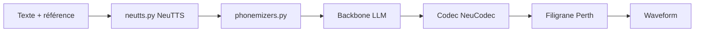

# neuphonic/neutts

> Local text-to-speech models with voice cloning, designed to run on-device.

## The problem
Realistic speech synthesis goes through paid web APIs, which rules it out for toys, embedded applications or compliance-bound contexts.

## What it actually does
A collection of TTS models built on small LLMs (NeuTTS-Air ~360M, Nano ~120M, 2E with emotion) plus the NeuCodec codec. Cloning from 3 seconds of reference audio, English, French, German and Spanish variants, GGUF Q4/Q8 quantizations, an ONNX decoder, streaming in GGUF. Every output carries a Perth watermark. Context of 2048 tokens, about 30 seconds of audio.

## How it is wired


## Trying it
```bash
pip install neutts
python -m examples.basic_example \
  --input_text "My name is Andy. I'm 25 and I just moved to London." \
  --ref_audio samples/jo.wav \
  --ref_text samples/jo.txt
```

## Cost and gotchas
Free, runs on CPU; llama-cpp-python must be compiled for the GGUFs. Mixed licenses: Apache 2.0 for Air, "NeuTTS Open License 1.0" for Nano and 2E, and GitHub does not recognize the repository's license. With `uv sync`, the watermark is disabled.

## What it is not
Not a hosted service. The benchmarks only count the language model, not the codec. The neutts.com sites are not affiliated.

## Alternatives
No alternative named in the README.

## For you
Worth adopting on a trial basis: local TTS with cloning, pip-installable, useful for voice agents; check the model license first before any commercial use.
