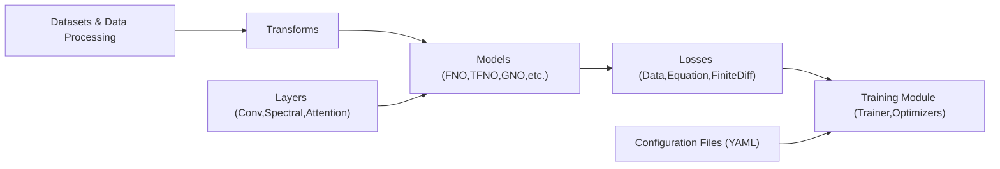

# neuraloperator/neuraloperator

> PyTorch library of neural operators (including FNO) that learn mappings between function spaces.

## The problem
A classic network learns a mapping at fixed resolution; for partial differential equations, we want an operator applied at any resolution.

## What it actually does
The library provides the official implementation of the Fourier Neural Operator and other architectures (`FNO`, `TFNO`, GNO…). It offers tensorized variants (Tucker) with fewer parameters, spectral layers, datasets, loss functions and a `Trainer`. Training scripts (Darcy, Burgers) and YAML configuration files serve for experiments; logging to W&B is optional. It is part of the PyTorch ecosystem.

## How it is wired


## Trying it
```bash
pip install neuraloperator
git clone https://github.com/NeuralOperator/neuraloperator
cd neuraloperator
pip install -e .
pip install -r requirements.txt
```
For W&B, put the key in `neuraloperator/config/wandb_api_key.txt`.

## Cost and gotchas
Free. The README specifies neither a Python version nor a GPU requirement. W&B tracking requires an account and a key in a local file: do not commit it.

## What it is not
It is not a general-purpose deep learning library: it targets scientific ML (PDEs, physical phenomena). Resolution invariance is a property of the model, to be verified on your data. The README is in raw reStructuredText, hard to read.

## Alternatives
No alternative named in the README.

## For you
Worth watching: a reference for operator learning, but niche; useful if you do scientific ML or simulation, irrelevant for ordinary data or MLOps.
