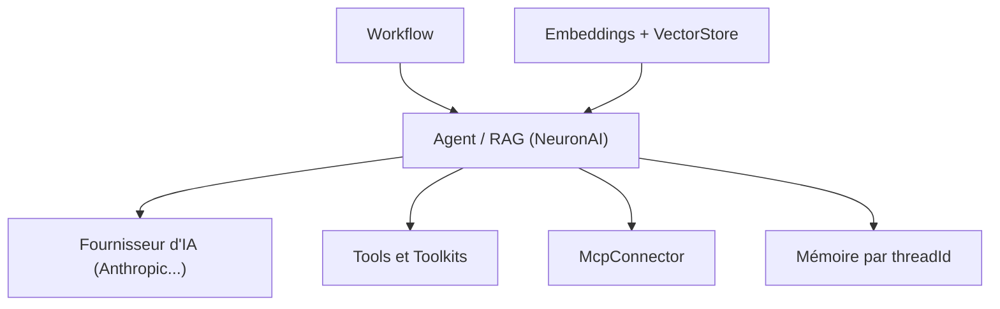

# neuron-core/neuron-ai

> PHP framework for building and orchestrating AI agents: tools, RAG, workflows, MCP.

## The problem
Agent frameworks are mostly in Python or JavaScript; a PHP application (Laravel, Symfony) has to assemble providers, tools and memory itself.

## What it actually does
The `Agent` class provides conversation memory, tools and structured output. Toolkits (MySQL, read-only inside a transaction), an MCP connector and a `RAG` class (vector store, embeddings) complete the set. Workflows orchestrate multi-agent systems with human validation, streaming and asynchronous execution.

## How it is wired
Simplified diagram based on the sheet, no diagram provided.



## Trying it
```bash
composer require neuron-core/neuron-ai
vendor/bin/neuron make:agent DataAnalystAgent
vendor/bin/neuron make:rag MyChatBot
```

## Cost and gotchas
PHP 8.1 or higher and the API key of the chosen provider are required (and, for a RAG, a vector store such as Pinecone and embeddings). The MySQL toolkit reads everything the connection user can read: the README advises a dedicated read-only user.

## What it is not
Not a Python framework: it targets the PHP ecosystem. Part of the README is promotional (newsletter, partner ecosystem, recruiting).

## Alternatives
No alternative named in the README.

## For you
Watch: relevant only if your stack is PHP; otherwise a Python framework remains more natural for a data / AI profile.
