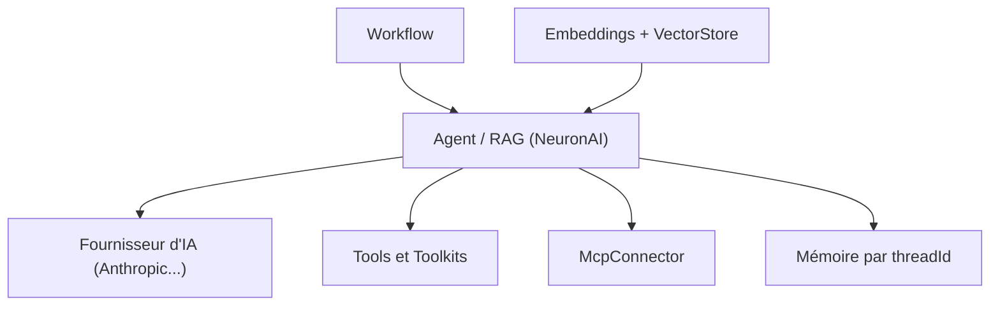

# neuron-core/neuron-ai

> Framework PHP pour créer et orchestrer des agents d'IA : outils, RAG, workflows, MCP.

## Le problème
Les frameworks d'agents sont surtout en Python ou en JavaScript ; une application PHP (Laravel, Symfony) doit assembler elle-même fournisseurs, outils et mémoire.

## Ce que ça fait vraiment
La classe `Agent` apporte mémoire de conversation, outils et sortie structurée. Des toolkits (MySQL, en lecture seule dans une transaction), un connecteur MCP et une classe `RAG` (stockage vectoriel, embeddings) complètent l'ensemble. Les workflows orchestrent des systèmes multi-agents avec validation humaine, streaming et exécution asynchrone.

## Comment c'est branché
Schéma simplifié d'après la fiche, sans diagramme fourni.



## Essayer
```bash
composer require neuron-core/neuron-ai
vendor/bin/neuron make:agent DataAnalystAgent
vendor/bin/neuron make:rag MyChatBot
```

## Coût et pièges
Il faut PHP 8.1 ou plus et la clé d'API du fournisseur choisi (et, pour un RAG, un stockage vectoriel comme Pinecone et des embeddings). Le toolkit MySQL lit tout ce que l'utilisateur de la connexion peut lire : le README conseille un utilisateur dédié en lecture seule.

## Ce que ce n'est pas
Ce n'est pas un framework Python : il vise l'écosystème PHP. Une partie du README est promotionnelle (newsletter, écosystème de partenaires, recrutement).

## Alternatives
Aucune alternative nommée dans le README.

## Pour toi
À surveiller : pertinent seulement si ta pile est en PHP ; sinon un framework Python reste plus naturel pour un profil data / IA.

