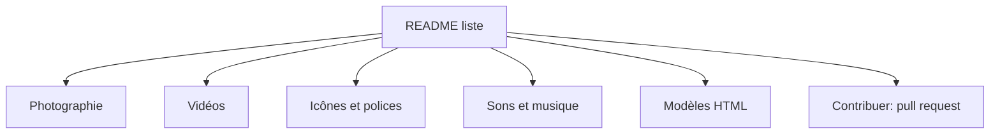

# neutraltone/awesome-stock-resources

> List of sites for royalty-free photos, videos, illustrations, icons and sounds, for creators and designers.

## The problem
Finding free visual or audio resources under a clear license forces you to search site by site.

## What it actually does
Index of links by category: photography (public domain), illustration, vectors, videos, patterns, textures, fonts, icons, colors, aggregated content, HTML templates, sounds and music, paid resources. Each entry carries a license icon (© CC0, public domain, attribution required). The README provided stops partway through the photo section according to the architecture, but the excerpt read does contain the other sections.

## How it is wired
No code: a single README.

## Trying it
No command documented: browse the README on GitHub.

## Cost and gotchas
Free, CC0-1.0. Licenses vary from site to site (CC0, attribution, personal use): check each resource. Some links may be dead; the maintainer acknowledges this and asks for pull requests.

## What it is not
Not a resource host: these are links to third-party sites. Nothing about datasets or training images.

## Alternatives
None named in the README.

## For you
Ignore: design and content resources, no data or models; keep the link only if you produce visuals.
