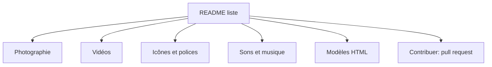

# neutraltone/awesome-stock-resources

> Liste de sites de photos, vidéos, illustrations, icônes et sons libres de droits, pour créateurs et designers.

## Le problème
Trouver des ressources visuelles ou sonores gratuites et sous licence claire oblige à chercher site par site.

## Ce que ça fait vraiment
Index de liens par catégorie : photographie (domaine public), illustration, vecteurs, vidéos, motifs, textures, polices, icônes, couleurs, contenu agrégé, modèles HTML, sons et musique, ressources payantes. Chaque entrée porte une icône de licence (© CC0, domaine public, attribution requise). Le README fourni s'arrête en partie dans la section photo d'après l'architecture, mais l'extrait lu contient bien les autres sections.

## Comment c'est branché
Aucun code : un README unique.

## Essayer
Aucune commande documentée : parcourir le README sur GitHub.

## Coût et pièges
Gratuit, CC0-1.0. Les licences varient d'un site à l'autre (CC0, attribution, usage personnel) : vérifier chaque ressource. Des liens peuvent être morts, le mainteneur le reconnaît et demande des pull requests.

## Ce que ce n'est pas
Pas un hébergeur de ressources : ce sont des liens vers des sites tiers. Rien sur les datasets ou images d'entraînement.

## Alternatives
Aucune nommée dans le README.

## Pour toi
Ignorer : ressources de design et de contenu, pas de données ni de modèles ; garde le lien seulement si tu produis des visuels.

