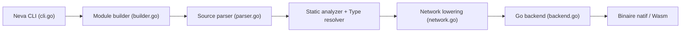

# nevalang/neva

> Statically typed dataflow programming language compiled to Go, for those curious about concurrency.

## The problem
Classic languages treat concurrency as an advanced option and dataflow remains under-represented. Visual flow tools lack expressiveness.

## What it actually does
A program is a network of nodes exchanging messages through ports; everything runs in parallel by default. The compiler analyzes types, lowers the network, then emits Go code (goroutines and channels) that becomes a native binary or Wasm. Go interoperability is announced; the visual editor is marked WIP.

## How it is wired


## Trying it
```bash
# Aucune commande d'installation dans le README ; seul un exemple Hello, World! en .neva est fourni
```

## Cost and gotchas
Free, no key. A Go toolchain is required downstream to produce the binaries. Several backend and runtime details are undocumented.

## What it is not
Not a data pipeline tool or an ETL framework: it is a general-purpose language. The visual editor is not finished. Library ecosystem to be checked.

## Alternatives
No alternative named in the README (it compares itself to Go as a compilation target).

## For you
Worth watching: conceptually interesting for concurrency, but with no data/AI ecosystem, it replaces nothing in an MLOps flow today.
