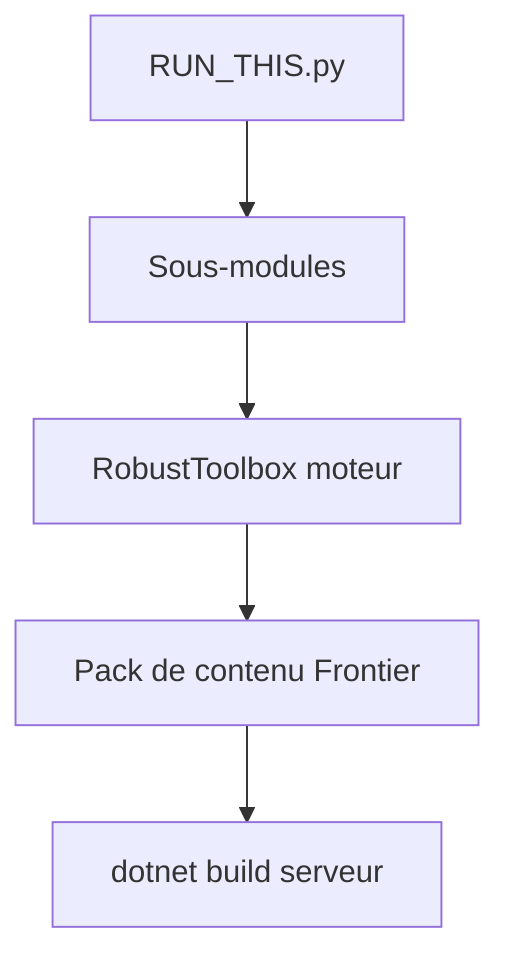

# new-frontiers-14/frontier-station-14

> Fork of Space Station 14 on the Robust Toolbox engine in C#, for hosting or creating game content.

## The problem
Community Space Station 14 servers want their own content and rules, distinct from the original game.

## What it actually does
The repository contains the RobustToolbox engine and the Frontier Station content pack. It is used to host a server or develop content. The README points to a wiki, Discord, Steam and Patreon for the rest.

## How it is wired
Simplified diagram based on the sheet, no diagram provided.



## Trying it
```shell
git clone https://github.com/new-frontiers-14/frontier-station-14.git
cd frontier-station-14
python RUN_THIS.py
dotnet build
```

## Cost and gotchas
Free. You need Python for the initialization script and the .NET SDK to build, the latter not being in the prerequisites list. The AGPL-3.0 license requires publishing the modifications of an exposed server.

## What it is not
Not a game to download as is: it is the development and hosting repository. 168 open issues show a very active but loaded project.

## Alternatives
No alternative named in the README; it only describes its origin, Space Station 14.

## For you
Ignore: community game server, unrelated to data, AI or MLOps work.
