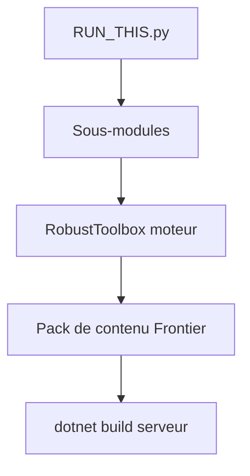

# new-frontiers-14/frontier-station-14

> Fork de Space Station 14 sur le moteur Robust Toolbox en C#, pour héberger ou créer du contenu de jeu.

## Le problème
Les serveurs communautaires de Space Station 14 veulent un contenu et des règles propres, distincts du jeu d'origine.

## Ce que ça fait vraiment
Le dépôt contient le moteur RobustToolbox et le pack de contenu de Frontier Station. Il sert à héberger un serveur ou à développer du contenu. Le README renvoie vers un wiki, Discord, Steam et Patreon pour le reste.

## Comment c'est branché
Schéma simplifié d'après la fiche, sans diagramme fourni.



## Essayer
```shell
git clone https://github.com/new-frontiers-14/frontier-station-14.git
cd frontier-station-14
python RUN_THIS.py
dotnet build
```

## Coût et pièges
Gratuit. Il faut Python pour le script d'initialisation et le SDK .NET pour compiler, ce dernier n'étant pas dans la liste des prérequis. La licence AGPL-3.0 impose de publier les modifications d'un serveur exposé.

## Ce que ce n'est pas
Pas un jeu à télécharger tel quel : c'est le dépôt de développement et d'hébergement. 168 tickets ouverts montrent un projet très actif mais chargé.

## Alternatives
Aucune alternative nommée dans le README ; il décrit seulement son origine, Space Station 14.

## Pour toi
À ignorer : serveur de jeu communautaire, sans rapport avec un travail data, IA ou MLOps.

