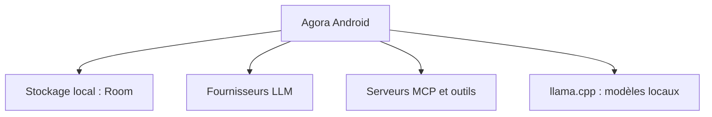

# newo-ether/Agora

> Open source Android client for using your own LLM accounts, with MCP, tools and remote control.

## The problem
LLM chat applications impose their provider and store conversations server-side.

## What it actually does
Android client (Kotlin, Compose) with personal keys: ten provider types (OpenAI, Anthropic, Gemini, Ollama, local llama.cpp…), tree-shaped conversations, context compaction, MCP servers, web search, memory, remote shell. Conversations stay local and requests go directly to the chosen provider.

## How it is wired
Simplified diagram based on the sheet, no diagram provided.



## Trying it
```bash
# Aucune commande documentée : installer l'application, puis
# Réglages > Providers (clés) > Models, et choisir un modèle.
```

## Cost and gotchas
Free, but calls to providers are billed to you. Secrets may remain in clear text in DataStore and `.agora` exports are not encrypted.

## What it is not
Not a relay: no Agora server passes your requests. A third-party application, "金龙AI-Pro", reuses its code under another name; only the official distribution is reliable.

## Alternatives
No alternative named in the README.

## For you
Worth watching: a mobile client with personal keys and MCP is handy, but the repository was cloned and relicensed under GPL-3.0 (v2.2.0+) after that incident.
