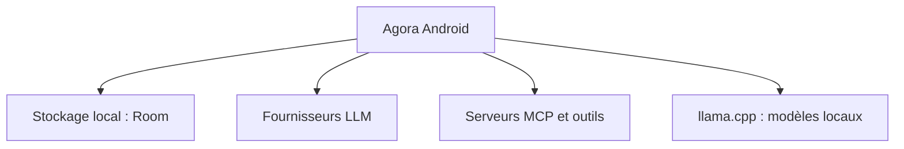

# newo-ether/Agora

> Client Android open source pour utiliser ses propres comptes LLM, avec MCP, outils et contrôle distant.

## Le problème
Les applications de chat LLM imposent leur fournisseur et stockent les conversations côté serveur.

## Ce que ça fait vraiment
Client Android (Kotlin, Compose) à clés personnelles : dix types de fournisseurs (OpenAI, Anthropic, Gemini, Ollama, llama.cpp local…), conversations en arbre, compactage du contexte, serveurs MCP, recherche web, mémoire, shell distant. Les conversations restent locales et les requêtes partent directement vers le fournisseur choisi.

## Comment c'est branché
Schéma simplifié d'après la fiche, sans diagramme fourni.



## Essayer
```bash
# Aucune commande documentée : installer l'application, puis
# Réglages > Providers (clés) > Models, et choisir un modèle.
```

## Coût et pièges
Gratuit, mais les appels aux fournisseurs sont facturés à ta charge. Des secrets peuvent rester en clair dans DataStore et les exports `.agora` ne sont pas chiffrés.

## Ce que ce n'est pas
Pas un relais : aucun serveur Agora ne passe tes requêtes. Une application tierce, « 金龙AI-Pro », reprend son code sous un autre nom ; seule la distribution officielle est fiable.

## Alternatives
Aucune alternative nommée dans le README.

## Pour toi
Surveiller : un client mobile à clés personnelles avec MCP est pratique, mais le dépôt a été cloné et relicencié en GPL-3.0 (v2.2.0+) après cet incident.

