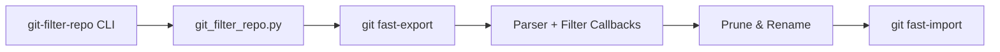

# newren/git-filter-repo

> A fast and safe Git history rewriting tool that replaces filter-branch and BFG.

## The problem
`git filter-branch` is very slow and tricky, and BFG only covers a few kinds of rewriting.

## What it actually does
A single Python script that reads `git fast-export`, applies filters (keep or remove paths, rename, change tags, rewrite messages) then feeds `git fast-import`. It removes commits that have become empty, refuses to run outside a fresh clone unless `--force`, then repacks. It also serves as a library.

## How it is wired


## Trying it
```bash
git filter-repo --path src/ --to-subdirectory-filter my-module --tag-rename '':'my-module-'
```

## Cost and gotchas
Free; git >= 2.36.0 and Python >= 3.6. Rewrites history: do it on a fresh clone. License not identified by GitHub.

## What it is not
Not a backup tool: the old history is deleted. It has no graphical interface.

## Alternatives
git filter-branch and BFG Repo Cleaner, presented as slower or more limited; filter-lamely and bfg-ish derive from it.

## For you
Adopt: essential for purging a large file or a secret from a data or model repository.
