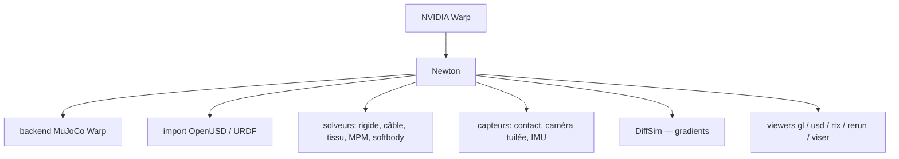

# newton-physics/newton

> Differentiable GPU physics simulation engine, aimed at roboticists and researchers.

## The problem
Simulating a robot requires a fast, differentiable engine able to import standard descriptions.
Existing engines are either CPU-bound, closed, or non-differentiable.

## What it actually does
Built on NVIDIA Warp, it generalizes the (deprecated) `warp.sim` module and integrates MuJoCo Warp as its main backend.
It emphasizes GPU computation, OpenUSD support, differentiability and user extensibility.
The example library covers rigid bodies (pendulum, URDF, joints), robots (G1, H1, ANYmal, UR10, Panda, Allegro), controllers (joint impedance, differential IK), cables, cloth, granular MPM, sensors and DiffSim.
Five viewers can be selected at launch — `gl`, `usd`, `rtx`, `rerun`, `viser` — plus `null` for pure computation.

## How it is wired


## Trying it
```bash
pip install "newton[examples]"
python -m newton.examples
python -m newton.examples --list
python -m newton.examples basic_urdf --device cuda:0
python -m newton.examples basic_viewer --viewer usd --output-path my_output.usd
```

## Cost and gotchas
Free, Apache-2.0 for the code and CC-BY-4.0 for the documentation, third-party licenses in `newton/licenses`.
It needs an NVIDIA Maxwell or newer GPU with driver 545+ (CUDA 12); no local CUDA Toolkit is required, but macOS runs on CPU only.

## What it is not
It is not a turnkey simulator with an editor: it is a Python library driven from the command line.
Nor is it stable in the sense of a frozen API — the versioning and deprecation policy is deferred to the compatibility guide.

## Alternatives
- MuJoCo Warp: the backend itself, if you do not need the Newton layer.
- `warp.sim`: the original module, deprecated and replaced by this repository.

## For you
Linux Foundation governance and GPU differentiability make it the reference to follow if you work on simulated robotics.
