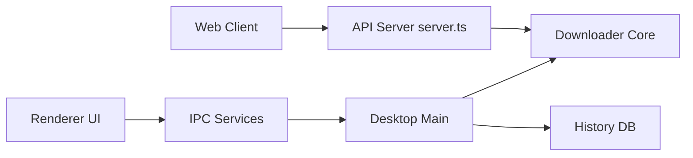

# nexmoe/VidBee

> Desktop app that downloads videos and audio, transcribes them locally and summarizes them with the AI of your choice.

## The problem
Downloading, transcribing and summarizing media means chaining yt-dlp, ffmpeg, a speech recognition model and an LLM.

## What it actually does
Downloads from over 1,000 sites (queue, pause/resume), subscribes to RSS feeds with filters, transcribes locally (Whisper, SenseVoice, Parakeet, Qwen3-ASR) with speakers and timestamps, then runs AI prompts (summary, translation, FAQ) against the provider of your choice. A web version + Docker API is also available.

## How it is wired


## Trying it
```bash
pnpm run start:web
docker compose up -d --build
docker compose down
```

## Cost and gotchas
Free. Transcription is local; AI prompts send the text to the chosen provider, except Ollama or LM Studio. API keys for cloud providers are at your expense.

## What it is not
Not a hosted service. Downloading depends on yt-dlp and on respecting the source sites' terms. The README states "under active development".

## Alternatives
None named in the README.

## For you
Worth watching: useful for transcribing conferences locally, but a consumer tool with no documented stable API for a data pipeline.
