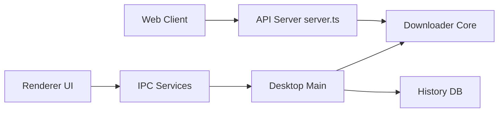

# nexmoe/VidBee

> Application de bureau qui télécharge vidéos et audios, les transcrit en local et les résume avec l'IA de ton choix.

## Le problème
Télécharger, transcrire et résumer des médias demande d'enchaîner yt-dlp, ffmpeg, un modèle de reconnaissance vocale et un LLM.

## Ce que ça fait vraiment
Télécharge depuis plus de 1 000 sites (file d'attente, pause/reprise), s'abonne à des flux RSS avec filtres, transcrit en local (Whisper, SenseVoice, Parakeet, Qwen3-ASR) avec locuteurs et horodatage, puis lance des prompts IA (résumé, traduction, FAQ) vers le fournisseur choisi. Version web + API Docker aussi disponible.

## Comment c'est branché


## Essayer
```bash
pnpm run start:web
docker compose up -d --build
docker compose down
```

## Coût et pièges
Gratuit. Transcription locale ; les prompts IA envoient le texte au fournisseur choisi, sauf Ollama ou LM Studio. Des clés d'API sont à ta charge pour les fournisseurs cloud.

## Ce que ce n'est pas
Pas un service hébergé. Le téléchargement dépend de yt-dlp et du respect des conditions des sites sources. Le README précise « en développement actif ».

## Alternatives
Aucune nommée dans le README.

## Pour toi
À surveiller : utile pour transcrire des conférences en local, mais outil grand public sans API stable documentée pour un pipeline data.

