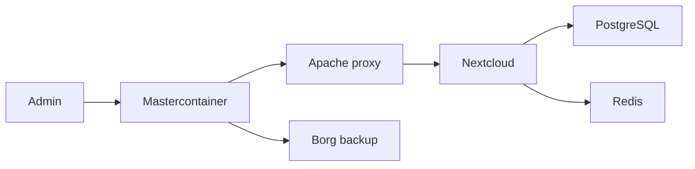

# nextcloud/all-in-one

> Official method to install Nextcloud in containers, with built-in updates and backups.

## The problem
Setting up Nextcloud with cache, database, office, video calls and backups by hand is long and fragile.

## What it actually does
A "mastercontainer" drives the containers through the Docker socket: Apache, Nextcloud, PostgreSQL, Redis, Notify Push, plus options (Office, Talk, ClamAV, Imaginary, full-text search, Whiteboard) and community containers. Borg backups, restore and updates from a web interface.

## How it is wired


## Trying it
```bash
sudo docker run --init --sig-proxy=false --name nextcloud-aio-mastercontainer --restart always --publish 80:80 --publish 8080:8080 --publish 8443:8443 --volume nextcloud_aio_mastercontainer:/mnt/docker-aio-config --volume /var/run/docker.sock:/var/run/docker.sock:ro ghcr.io/nextcloud-releases/all-in-one:latest
```

## Cost and gotchas
A domain (or a free deSEC subdomain) is required and ports must be opened; no bare IP, no offline installation, Podman not supported. The Docker socket is mounted in the mastercontainer. Beyond 100 users, the Enterprise edition is required.

## What it is not
Not an immutable or minimalist installation. Cloudflare Tunnel limits uploads (100 MB) and breaks Talk. README supplied partly truncated (FAQ sections merged).

## Alternatives
No alternative named, apart from the manual or Helm installations described.

## For you
Worth watching: handy for hosting storage and file sharing for a team, unrelated to models or pipelines.
