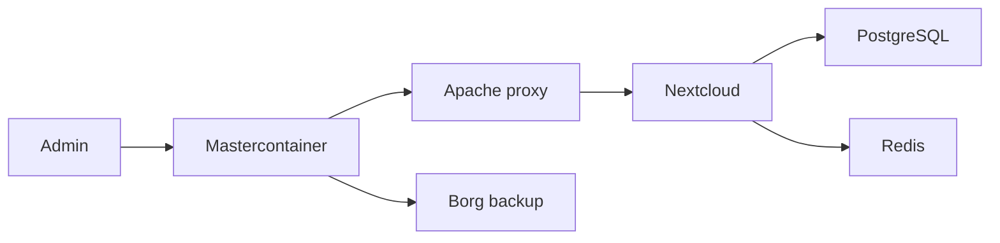

# nextcloud/all-in-one

> Méthode d'installation officielle de Nextcloud en conteneurs, avec mises à jour et sauvegardes intégrées.

## Le problème
Monter Nextcloud avec cache, base, office, visio et sauvegardes à la main est long et fragile.

## Ce que ça fait vraiment
Un « mastercontainer » pilote via le socket Docker les conteneurs : Apache, Nextcloud, PostgreSQL, Redis, Notify Push, plus des options (Office, Talk, ClamAV, Imaginary, recherche plein texte, Whiteboard) et des conteneurs communautaires. Sauvegardes Borg, restauration et mises à jour depuis une interface web.

## Comment c'est branché


## Essayer
```bash
sudo docker run --init --sig-proxy=false --name nextcloud-aio-mastercontainer --restart always --publish 80:80 --publish 8080:8080 --publish 8443:8443 --volume nextcloud_aio_mastercontainer:/mnt/docker-aio-config --volume /var/run/docker.sock:/var/run/docker.sock:ro ghcr.io/nextcloud-releases/all-in-one:latest
```

## Coût et pièges
Il faut un domaine (ou un sous-domaine deSEC gratuit) et ouvrir des ports ; pas d'IP seule, pas d'installation hors ligne, Podman non supporté. Le socket Docker est monté dans le mastercontainer. Au-delà de 100 utilisateurs, l'édition Enterprise est requise.

## Ce que ce n'est pas
Pas une installation immuable ni minimaliste. Cloudflare Tunnel limite les envois (100 Mo) et casse Talk. README fourni en partie tronqué (sections FAQ fusionnées).

## Alternatives
Aucune alternative nommée, hormis les installations manuelles ou Helm décrites.

## Pour toi
À surveiller : pratique pour héberger du stockage et du partage de fichiers en équipe, sans lien avec les modèles ou pipelines.

