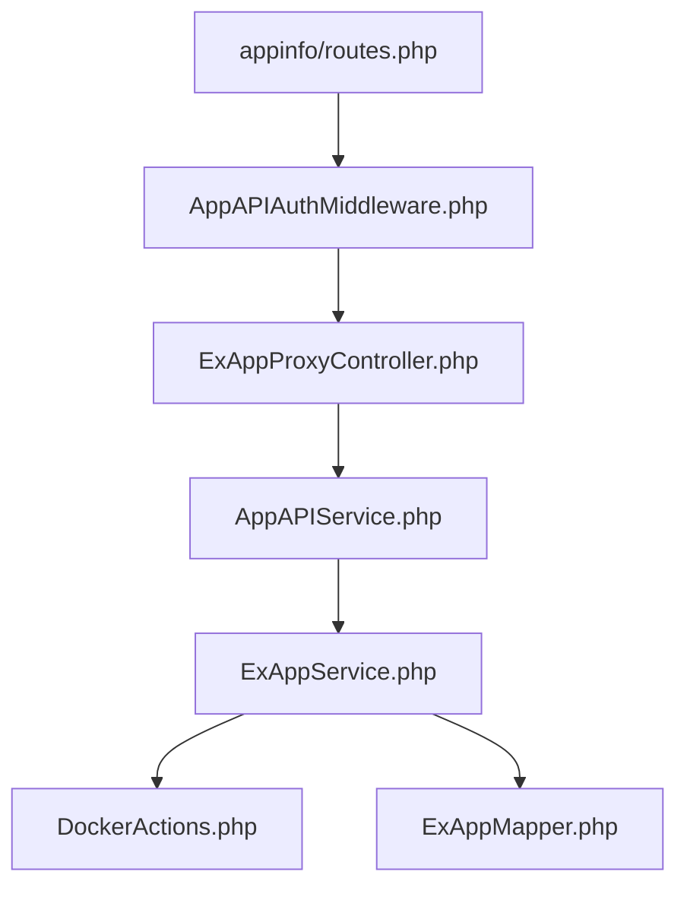

# nextcloud/app_api

> Nextcloud component that enables external applications whose backend runs outside PHP, often in a container.

## The problem
Writing Nextcloud applications in PHP limits the available languages and heavy workloads such as GPU.

## What it actually does
Requests go through the routes, an authentication middleware and a proxy controller to the services, which deploy ExApps via Docker or Kubernetes and record their state in the database. A deployment daemon (HaRP recommended, DSP legacy) is required.

## How it is wired


## Trying it
```bash
occ app:disable app_api
```

## Cost and gotchas
Free. Without a registered deployment daemon, no ExApp runs. Do not expose HaRP/DSP to the Internet.

## What it is not
Only useful for installing or developing ExApps; DSP is deprecated, removal planned with Nextcloud 35.

## Alternatives
HaRP: the recommended deployment daemon from Nextcloud 32.
Docker Socket Proxy: an older option, to be avoided.

## For you
Worth watching: only if you self-host Nextcloud and want to plug containerized AI services into it.
