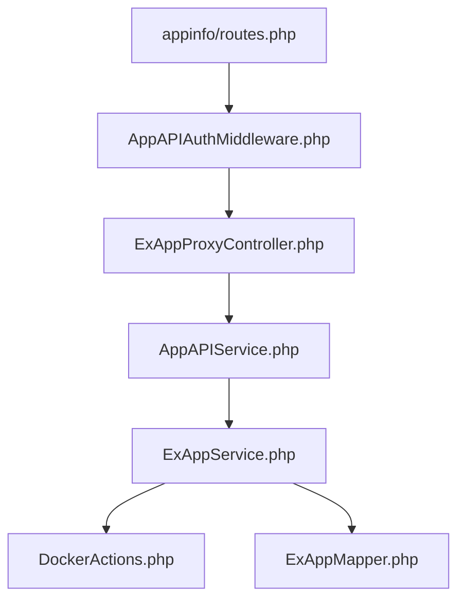

# nextcloud/app_api

> Composant Nextcloud qui permet des applications externes dont le backend tourne hors de PHP, souvent en conteneur.

## Le problème
Écrire des applications Nextcloud en PHP limite les langages et les charges lourdes comme le GPU.

## Ce que ça fait vraiment
Les requêtes passent par les routes, un middleware d'authentification et un contrôleur proxy vers les services, qui déploient les ExApps via Docker ou Kubernetes et enregistrent leur état en base. Un daemon de déploiement (HaRP recommandé, DSP ancien) est nécessaire.

## Comment c'est branché


## Essayer
```bash
occ app:disable app_api
```

## Coût et pièges
Gratuit. Sans daemon de déploiement enregistré, aucune ExApp ne tourne. Ne pas exposer HaRP/DSP à Internet.

## Ce que ce n'est pas
Utile seulement pour installer ou développer des ExApps ; le DSP est déprécié, retrait prévu avec Nextcloud 35.

## Alternatives
HaRP : daemon de déploiement recommandé à partir de Nextcloud 32.
Docker Socket Proxy : option ancienne, à éviter.

## Pour toi
À surveiller : seulement si tu auto-héberges Nextcloud et veux y brancher des services IA en conteneur.

