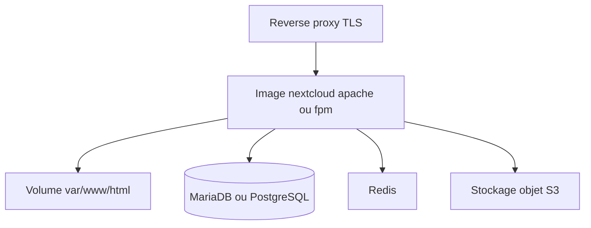

# nextcloud/docker

> Community Docker image of Nextcloud, for administrators building their own stack.

## The problem
Deploying Nextcloud properly in a container requires mastering volumes, database and configuration.

## What it actually does
Two variants: `apache` (server included) and `fpm` (to be paired with a web server). Automatic configuration through environment variables: SQLite, MySQL/MariaDB or PostgreSQL database, initial admin, Redis, SMTP, S3 or Swift object storage, PHP limits. Install and upgrade hooks, `occ` utility. The source README is truncated at the compose example.

## How it is wired

Diagram not provided: simplified from the README.

## Trying it
```bash
docker run -d -p 8080:80 nextcloud
docker run -d -v nextcloud:/var/www/html nextcloud
docker compose exec --user www-data app php occ
```

## Cost and gotchas
Free. Without a named volume or external database, data is fragile. The main folder is rewritten during upgrades: list custom volumes in `upgrade.exclude`. No TLS included.

## What it is not
Image aimed at experts, maintained by volunteers. For a simple deployment, the README points to Nextcloud All-in-One.

## Alternatives
- Nextcloud All-in-One (named in the README): simple deployment maintained by Nextcloud GmbH.

## For you
Worth watching: useful for self-hosted file storage, outside the data/AI core; keep the AGPL in mind.
