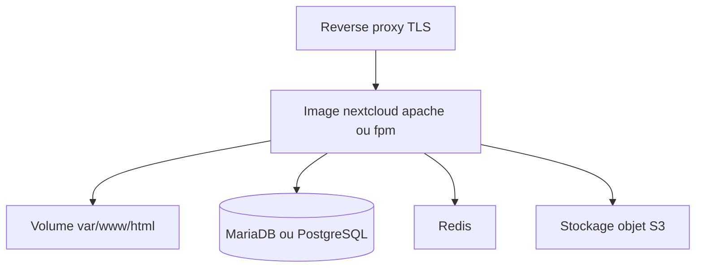

# nextcloud/docker

> Image Docker communautaire de Nextcloud, pour administrateurs qui montent leur propre pile.

## Le problème
Déployer Nextcloud proprement en conteneur demande de maîtriser volumes, base de données et configuration.

## Ce que ça fait vraiment
Deux variantes : `apache` (serveur inclus) et `fpm` (à coupler à un serveur web). Configuration automatique par variables d'environnement : base SQLite, MySQL/MariaDB ou PostgreSQL, admin initial, Redis, SMTP, stockage objet S3 ou Swift, limites PHP. Hooks d'installation et de mise à jour, utilitaire `occ`. Le README source est tronqué à l'exemple compose.

## Comment c'est branché

Schéma non fourni : diagramme simplifié d'après le README.

## Essayer
```bash
docker run -d -p 8080:80 nextcloud
docker run -d -v nextcloud:/var/www/html nextcloud
docker compose exec --user www-data app php occ
```

## Coût et pièges
Gratuit. Sans volume nommé ou base externe, données fragiles. Le dossier principal est réécrit lors des mises à jour : lister les volumes personnalisés dans `upgrade.exclude`. Pas de TLS inclus.

## Ce que ce n'est pas
Image destinée aux experts, maintenue par des bénévoles. Pour un déploiement simple, le README renvoie vers Nextcloud All-in-One.

## Alternatives
- Nextcloud All-in-One (nommé dans le README) : déploiement simple maintenu par Nextcloud GmbH.

## Pour toi
À surveiller : utile pour un stockage de fichiers autohébergé, hors du cœur data/IA ; AGPL à garder en tête.

