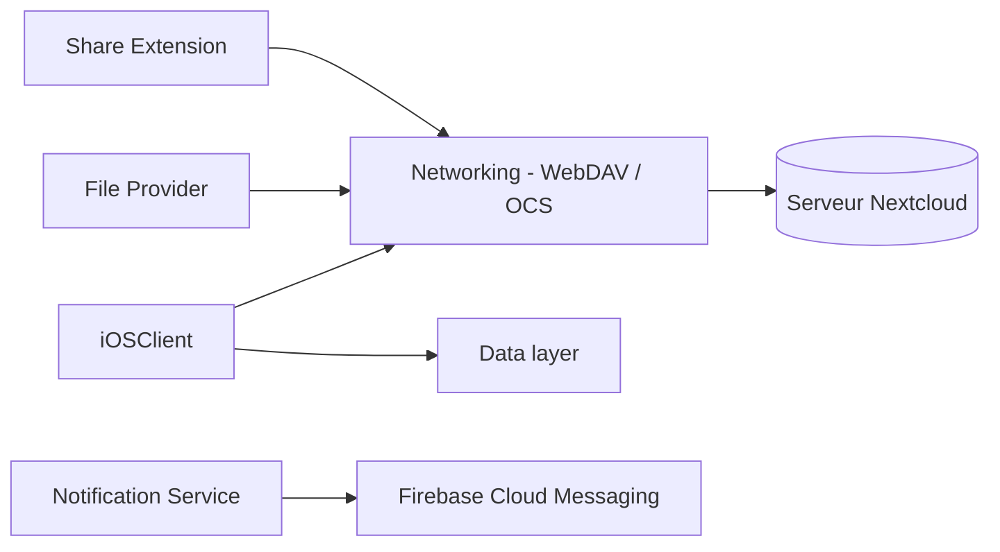

# nextcloud/ios

> Official Nextcloud iOS app to browse, sync and share your files.

## The problem
Accessing your Nextcloud server from an iPhone or iPad requires a native client with file upload and sharing.

## What it actually does
The README is mostly about contributing: forum, translations, DCO (`Signed-off-by` signature), `GoogleService-Info.plist` file required to build (Firebase), TestFlight, unit, integration (test Nextcloud server via `Tests/Server.sh`) and UI tests. According to the code: main application (WebDAV, end-to-end encryption, local database) and extensions: file provider, sharing, push notifications, widgets.

## How it is wired

## Trying it
No install command in the README (the app is downloaded from the App Store). Only a contribution workflow is documented: add a `Signed-off-by` (`git commit -s`), and run `Tests/Server.sh` before the integration tests.

## Cost and gotchas
Requires a Nextcloud server and Xcode 26.1 to build. Push via Firebase. `Tests/Server.sh` may delete a container with the same name: read the script first.

## What it is not
It is not a Nextcloud server, only the iOS client. It is under GPL-3.0.

## Alternatives
No alternative named in the README; NextcloudKit is cited for API tests.

## For you
Ignore: mobile client unrelated to data or MLOps.
