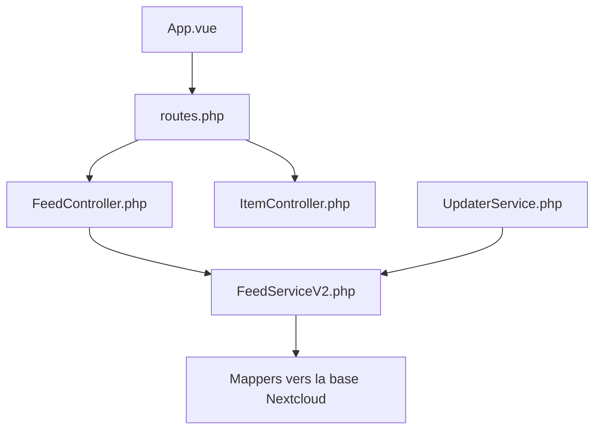

# nextcloud/news

> RSS/Atom feed reader built into Nextcloud, with a Vue client and a REST API.

## The problem
Following your news feeds without a third-party service, on your own Nextcloud instance.

## What it actually does
A Nextcloud application: a Vue client displays folders and feeds, and marks items read or starred. A PHP API (controllers, then services, then mappers) reads and writes to the database. Nextcloud scheduled jobs fetch and parse the feeds. It adds OPML import/export, sharing, search, feed discovery and podcast playback.

## How it is wired


## Trying it
```bash
# Aucune commande dans le README.
# Mise à jour : suivre https://github.com/nextcloud/news/releases.atom
```

## Cost and gotchas
Free, but requires a Nextcloud instance already running (PHP, database). AGPL license.

## What it is not
Not a standalone reader: it does not work without Nextcloud. Not an automated analysis or monitoring tool.

## Alternatives
No alternative named in the README.

## For you
Ignore: a personal RSS reader, only useful if you already host Nextcloud; nothing for data or AI.
