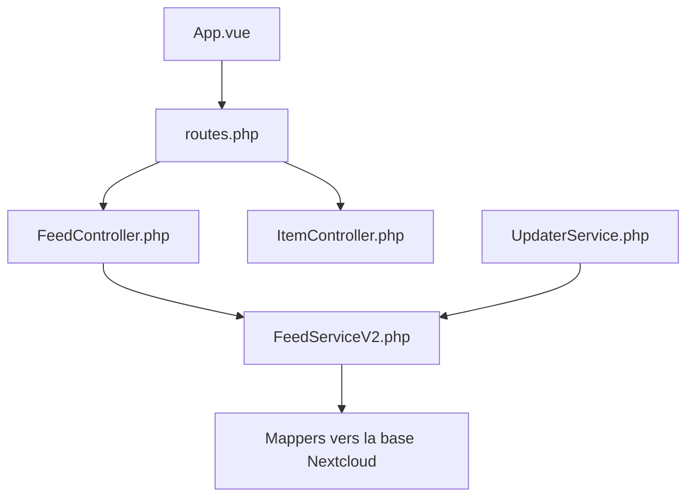

# nextcloud/news

> Lecteur de flux RSS/Atom intégré à Nextcloud, avec client Vue et API REST.

## Le problème
Suivre ses flux d'actualité sans service tiers, sur sa propre instance Nextcloud.

## Ce que ça fait vraiment
Application Nextcloud : un client Vue affiche dossiers et flux, marque lus ou favoris. Une API PHP (contrôleurs puis services puis mappers) lit et écrit en base. Des tâches planifiées de Nextcloud récupèrent et analysent les flux. S'y ajoutent import/export OPML, partage, recherche, découverte de flux et lecture de podcasts.

## Comment c'est branché


## Essayer
```bash
# Aucune commande dans le README.
# Mise à jour : suivre https://github.com/nextcloud/news/releases.atom
```

## Coût et pièges
Gratuit, mais exige une instance Nextcloud déjà en service (PHP, base de données). Licence AGPL.

## Ce que ce n'est pas
Pas un lecteur autonome : il ne fonctionne pas sans Nextcloud. Pas un outil d'analyse ou de veille automatisée.

## Alternatives
Aucune alternative nommée dans le README.

## Pour toi
Ignorer : un lecteur RSS personnel, utile seulement si tu héberges déjà Nextcloud ; rien pour la data ou l'IA.

