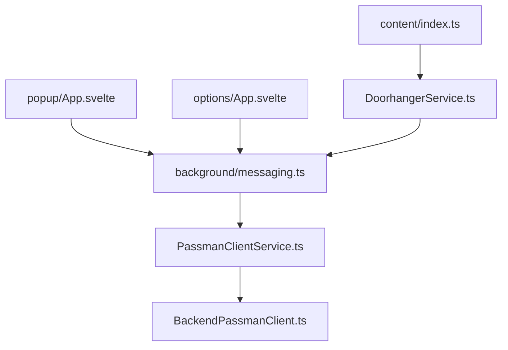

# nextcloud/passman-webextension

> Browser extension rewritten to use Nextcloud's Passman password manager.

## The problem
Credentials stored in the Nextcloud Passman vault do not fill in on their own in the browser.

## What it actually does
It connects to a Nextcloud instance and a Passman vault, lists and manages credentials, generates passwords, fills in forms and offers an in-page picker. A vault recovery function repairs badly encrypted credentials. Per-site rules, the doorhanger and the offline cache are experimental; passkeys are announced for later.

## How it is wired


## Trying it
```bash
bun install
bun run dev
bun run build
bun run zip         # For Chrome/Chromium
```

## Cost and gotchas
Free. Requires a Nextcloud instance with the Passman app and bun to build. Submitting to the stores requires the `ENV_SUBMIT` secret.

## What it is not
Not a standalone manager: without a Nextcloud Passman server, it is useless.

## Alternatives
No alternative named in the README.

## For you
Ignore: only useful if you already use Passman, unrelated to your field.
