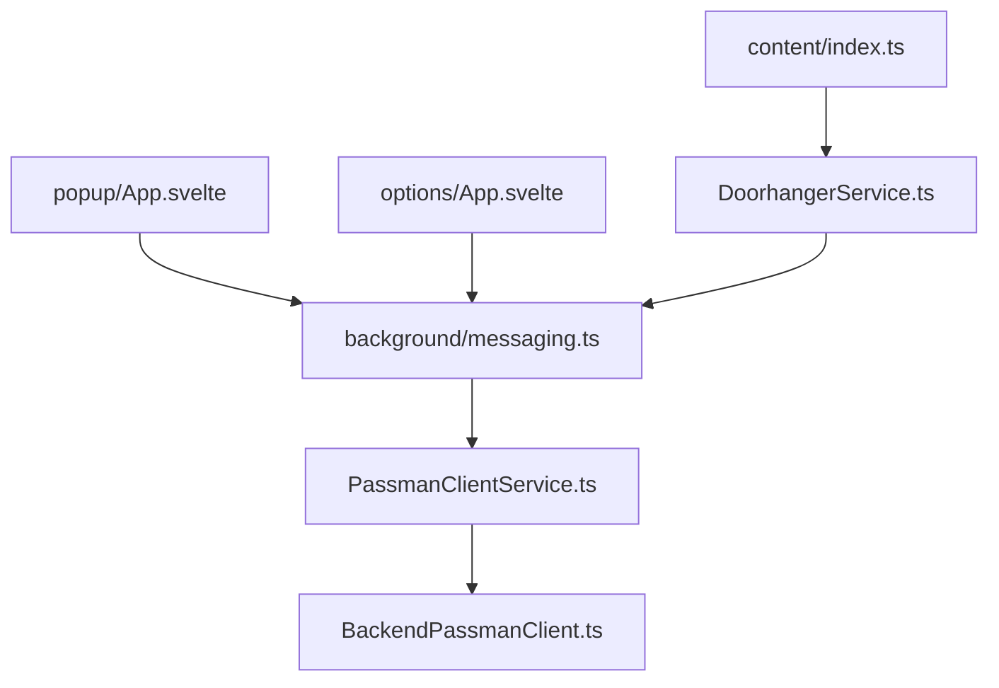

# nextcloud/passman-webextension

> Extension de navigateur réécrite pour utiliser le gestionnaire de mots de passe Passman de Nextcloud.

## Le problème
Les identifiants stockés dans le coffre Passman de Nextcloud ne se remplissent pas seuls dans le navigateur.

## Ce que ça fait vraiment
Elle se connecte à une instance Nextcloud et à un coffre Passman, liste et gère les identifiants, génère des mots de passe, remplit les formulaires et propose un sélecteur dans la page. Une fonction de récupération de coffre répare des identifiants mal chiffrés. Les règles par site, le doorhanger et le cache hors ligne sont expérimentaux ; les passkeys sont annoncées pour plus tard.

## Comment c'est branché


## Essayer
```bash
bun install
bun run dev
bun run build
bun run zip         # For Chrome/Chromium
```

## Coût et pièges
Gratuit. Demande une instance Nextcloud avec l'application Passman et bun pour compiler. La soumission aux boutiques exige le secret `ENV_SUBMIT`.

## Ce que ce n'est pas
Pas un gestionnaire autonome : sans serveur Nextcloud Passman, elle ne sert à rien.

## Alternatives
Aucune alternative nommée dans le README.

## Pour toi
Ignorer : utile seulement si tu utilises déjà Passman, sans lien avec ton métier.

