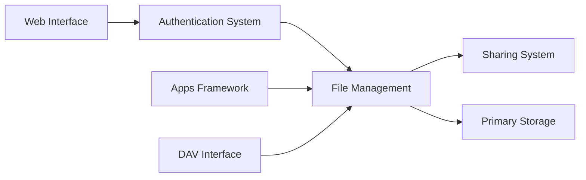

# nextcloud/server

> Self-hosted server for files, calendars, contacts and collaboration, extensible through apps.

## The problem
Storing, syncing and sharing your data without depending on a third-party cloud provider.

## What it actually does
PHP server with access through a web interface, mobile apps and desktop clients; sharing, authentication (2FA), encryption, DAV interface, federation, local or object storage (S3, Swift), background jobs and an app store. Enterprise edition sold by Nextcloud GmbH.

## How it is wired

## Trying it
No installation command in the README; to contribute: `git submodule update --init`.

## Cost and gotchas
Self-hosting: server, backups and updates are on you. Git submodules are mandatory for a checkout; `stable*` branches are not for production.

## What it is not
Not a data/AI tool. AGPL-3.0: network copyleft. Over 3,800 open issues.

## Alternatives
No alternative named in the README.

## For you
Ignore for your line of work: useful for personal or team infrastructure, unrelated to AI.
