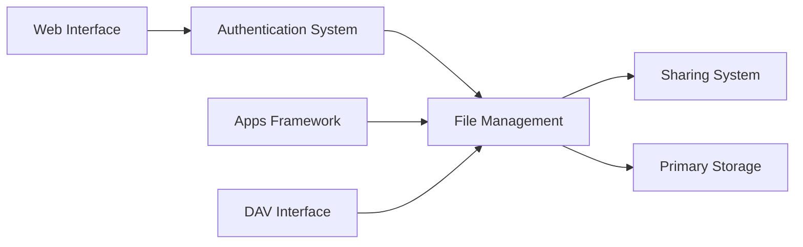

# nextcloud/server

> Serveur auto-hébergé de fichiers, calendriers, contacts et collaboration, extensible par des applications.

## Le problème
Stocker, synchroniser et partager ses données sans dépendre d'un fournisseur cloud tiers.

## Ce que ça fait vraiment
Serveur PHP avec accès par interface web, applications mobiles et clients de bureau ; partage, authentification (2FA), chiffrement, interface DAV, fédération, stockage local ou objet (S3, Swift), tâches de fond et boutique d'applications. Édition Enterprise vendue par Nextcloud GmbH.

## Comment c'est branché

## Essayer
Aucune commande d'installation dans le README ; pour contribuer : `git submodule update --init`.

## Coût et pièges
Auto-hébergement : serveur, sauvegardes et mises à jour à ta charge. Les sous-modules git sont obligatoires pour un checkout ; les branches `stable*` ne sont pas pour la production.

## Ce que ce n'est pas
Pas un outil data/IA. AGPL-3.0 : copyleft réseau. Plus de 3 800 issues ouvertes.

## Alternatives
Aucune alternative nommée dans le README.

## Pour toi
À ignorer pour ton métier : utile en infrastructure personnelle ou d'équipe, sans lien avec l'IA.

