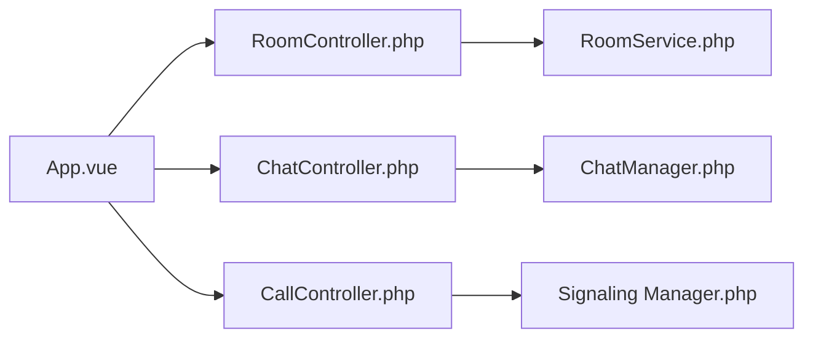

# nextcloud/spreed

> Video conferencing and messaging app integrated into Nextcloud, for self-hosted teams.

## The problem
Video and chat tools are third-party services separate from your files and calendar.

## What it actually does
Nextcloud app (PHP + Vue): private, group or password-protected public conversations, audio/video calls, screen sharing, polls, message threads, federated chat between servers and synchronization with other messengers via Matterbridge. Integrates with Files, Calendar, Contacts, Deck. A TURN server may be needed behind strict firewalls.

## How it is wired


## Trying it
```bash
make dev-setup
make build-js
# puis activer l'application dans la gestion des applications de Nextcloud
```

## Cost and gotchas
Free, but you need a Nextcloud instance; a TURN server is sometimes necessary. 884 open issues.

## What it is not
Not a standalone service: it runs inside Nextcloud. One branch per Nextcloud version.

## Alternatives
No alternative named in the README.

## For you
Worth watching: relevant if your team already has Nextcloud and wants sovereign video calls, of no interest on its own.
