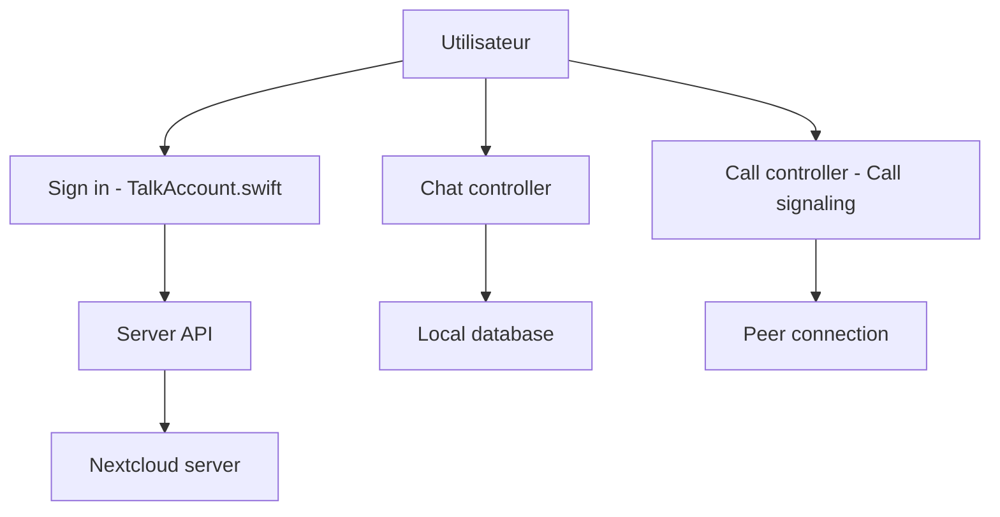

# nextcloud/talk-ios

> Official iOS client for Nextcloud Talk: chat and audio/video calls to your Nextcloud server.

## The problem
Using Nextcloud Talk on an iPhone without going through a messaging service hosted by a third party.

## What it actually does
Native iOS application: connects to a Nextcloud server, conversation list, messages and file sending, calls via signaling and a peer-to-peer WebRTC connection. It includes share and screen-upload extensions, and push notifications. The project ships its own WebRTC builds (version 150.7871.0).

## How it is wired


## Trying it
```bash
pod install
open NextcloudTalk.xcworkspace
./start-instance-for-tests.sh
xcodebuild test -workspace NextcloudTalk.xcworkspace -scheme "NextcloudTalk" -destination "platform=iOS Simulator,name=iPhone 16,OS=18.5" -test-iterations 3 -retry-tests-on-failure
```

## Cost and gotchas
Free, but it requires a Nextcloud 22+ server with Talk 12+ and CocoaPods. To build it yourself, change the `com.nextcloud.Talk` bundle ids and the app groups, then `NCAppBranding.m`. The tests require a Nextcloud instance running under Docker.

## What it is not
Not a server: you already need a Nextcloud. Not a reusable library. GPL-3.0 license with an App Store exception.

## Alternatives
No alternative named in the README.

## For you
Ignore for data/AI monitoring: it is a mobile messaging client, useful only if your team uses Nextcloud and develops on iOS.
