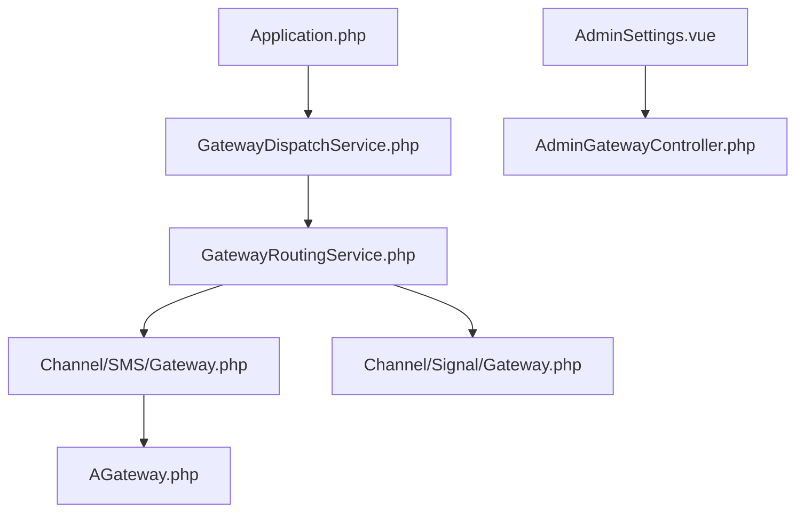

# nextcloud/twofactor_gateway

> Nextcloud two-factor authentication providers via Signal, SMS, Telegram, WhatsApp or XMPP.

## The problem
Nextcloud's second factor goes through dedicated apps, not through common messaging services.

## What it actually does
Sends login codes through one of the channels. A dispatch service chooses the channel via routing, each channel extending `AGateway`. The Vue administration interface configures the gateways through a controller. Applications without Login flow accept device passwords.

## How it is wired


## Trying it
```bash
# aucune commande dans le README : voir la documentation d'administration
```

## Cost and gotchas
Free, but sending SMS or messages depends on third-party services, sometimes paid. Requires a Nextcloud instance.

## What it is not
Not a standalone tool: it is a Nextcloud application in PHP. It does not replace real authentication.

## Alternatives
No alternative named in the README.

## For you
Ignore: a Nextcloud module outside your data / AI scope.
