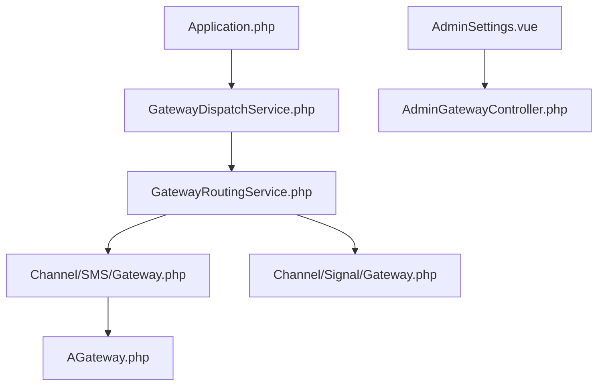

# nextcloud/twofactor_gateway

> Fournisseurs Nextcloud d'authentification à deux facteurs par Signal, SMS, Telegram, WhatsApp ou XMPP.

## Le problème
Le deuxième facteur de Nextcloud passe par des applications dédiées, pas par les messageries courantes.

## Ce que ça fait vraiment
Envoie les codes de connexion par l'un des canaux. Un service de dispatch choisit le canal via un routage, chaque canal étendant `AGateway`. L'interface d'administration Vue configure les passerelles via un contrôleur. Les applications sans Login flow acceptent des mots de passe d'appareil.

## Comment c'est branché


## Essayer
```bash
# aucune commande dans le README : voir la documentation d'administration
```

## Coût et pièges
Gratuit, mais l'envoi de SMS ou de messages dépend de services tiers, parfois payants. Nécessite une instance Nextcloud.

## Ce que ce n'est pas
Pas un outil autonome : c'est une application Nextcloud en PHP. Elle ne remplace pas une vraie authentification.

## Alternatives
Aucune alternative nommée dans le README.

## Pour toi
Ignorer : un module Nextcloud hors de ton périmètre data / IA.

