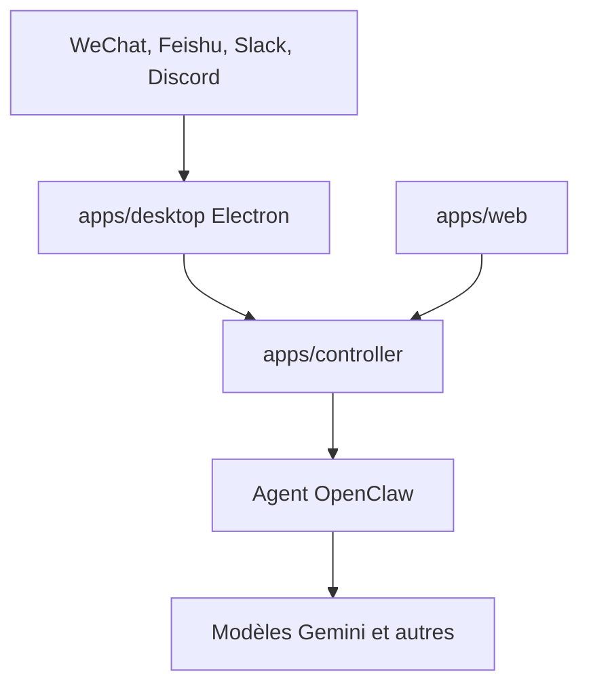

# nexu-io/nexu

> Open source desktop client that connects an OpenClaw agent to WeChat, Feishu, Slack and Discord.

## The problem
Connecting an AI agent to messaging apps requires command-line configuration and manual integration for each channel.

## What it actually does
An Electron application (macOS, Windows) that installs the OpenClaw agent, its skills and those of Feishu. You scan a WeChat code or authorize a channel, then talk to the agent from your phone. Models come from your nexu account or your own keys; MiniMax, Codex and GLM go through OAuth.

## How it is wired
Simplified diagram based on the sheet, no diagram provided.


## Trying it
```bash
pnpm dev start
pnpm build
pnpm lint
pnpm test
```

## Cost and gotchas
The client is free; model providers are at your expense with your keys. A nexu account is required for the built-in models. Node.js 22+ and pnpm 10+ to develop.

## What it is not
Not an agent: it depends on OpenClaw. No Linux among the listed platforms. The claim "all data stays on your machine" comes from the README alone.

## Alternatives
- OpenClaw (official): free but you have to deploy and configure it from the command line.

## For you
Ignore: it is a messaging gateway for a personal agent, unrelated to your data or MLOps pipelines.
