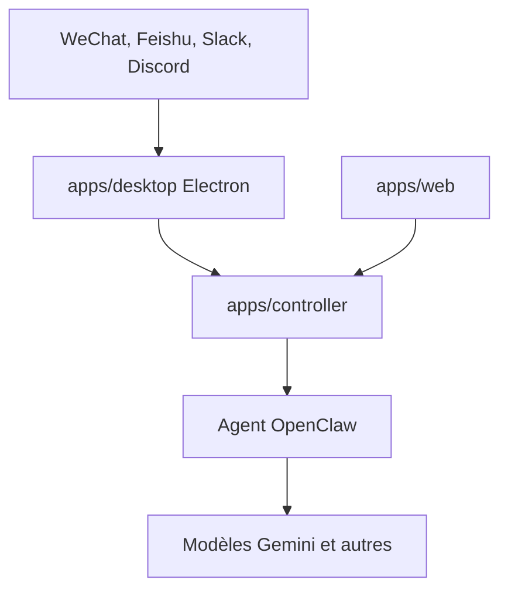

# nexu-io/nexu

> Client de bureau open source qui relie un agent OpenClaw à WeChat, Feishu, Slack et Discord.

## Le problème
Brancher un agent IA sur des messageries demande de la configuration en ligne de commande et de l'intégration manuelle pour chaque canal.

## Ce que ça fait vraiment
Une application Electron (macOS, Windows) qui installe l'agent OpenClaw, ses skills et ceux de Feishu. Tu scannes un code WeChat ou tu autorises un canal, puis tu parles à l'agent depuis ton téléphone. Les modèles viennent de ton compte nexu ou de tes propres clés ; MiniMax, Codex et GLM passent par OAuth.

## Comment c'est branché
Schéma simplifié d'après la fiche, sans diagramme fourni.


## Essayer
```bash
pnpm dev start
pnpm build
pnpm lint
pnpm test
```

## Coût et pièges
Le client est gratuit ; les fournisseurs de modèles sont à ta charge avec tes clés. Compte nexu requis pour les modèles intégrés. Node.js 22+ et pnpm 10+ pour développer.

## Ce que ce n'est pas
Pas un agent : il dépend d'OpenClaw. Pas de Linux dans les plateformes listées. L'affirmation « toutes les données restent sur ta machine » vient du README seul.

## Alternatives
- OpenClaw (officiel) : gratuit mais à déployer et configurer en ligne de commande.

## Pour toi
À ignorer : c'est une passerelle messagerie pour agent personnel, sans lien avec tes pipelines data ou MLOps.

