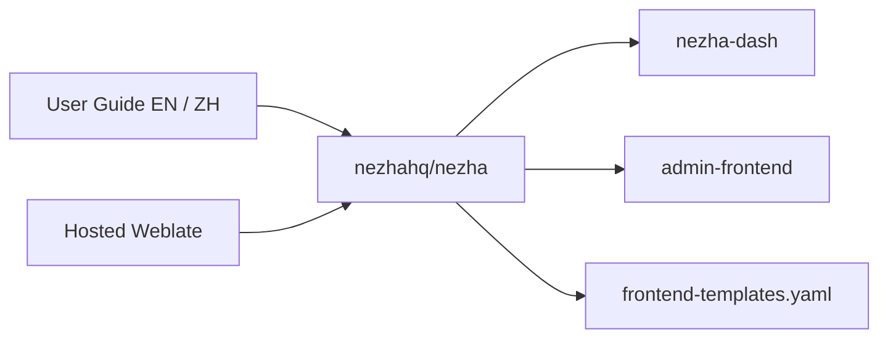

# nezhahq/nezha

> Server monitoring tool with interchangeable themes, documented in Chinese and English.

## The problem
Not documented in this README: the supplied text describes neither the need nor how it works.

## What it actually does
The available README is limited to links: user guide (English and Chinese), Telegram channels, translations hosted on Weblate, screenshots of a user front end (`hamster1963/nezha-dash`) and of an admin console (`nezhahq/admin-frontend`). Themes are declared by adding an entry in `service/singleton/frontend-templates.yaml`. Nothing else is described.

## How it is wired

## Trying it
No command documented in this README.

## Cost and gotchas
Not documented: neither prerequisites, installation nor dependencies appear in the supplied text.

## What it is not
Impossible to say from this README: it contains no functional description, no limits, no license. Insufficient material to decide — any judgment would require reading the external documentation, out of reach for this sheet.

## Alternatives
No alternative repo is named in the README.

## For you
Set aside as is: nothing in the README allows evaluating the tool.
