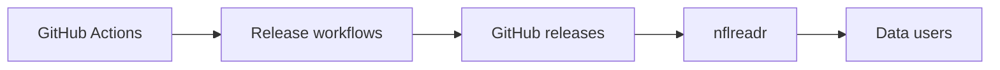

# nflverse/nflverse-data

> Repository of automated American football data releases for the nflverse projects.

## The problem
NFL statistics are scattered and collecting them is redone by hand.

## What it actually does
GitHub Actions workflows collect the data and publish it as GitHub releases. The README (under 800 characters) says it is downloaded with the R package `{nflreadr}` or manually from the releases page, organized according to nflreadr's functions. The precise content of the datasets is not described here.

## How it is wired

## Trying it
No documented command: use `{nflreadr}` in R or download from the releases page.

## Cost and gotchas
Free, CC-BY-4.0 license (attribution required). The automation status is on an external page, not included.

## What it is not
Not a real-time API: these are files published through releases. The exact content remains to be verified.

## Alternatives
The README names no alternative.

## For you
Worth watching: an open, automated sports data source, useful for data science exercises if you are interested in sports, but the README is too thin to judge coverage.
