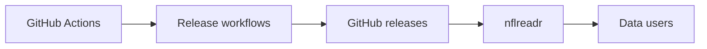

# nflverse/nflverse-data

> Dépôt de publications automatisées de données de football américain pour les projets nflverse.

## Le problème
Les statistiques NFL sont dispersées et leur collecte se refait à la main.

## Ce que ça fait vraiment
Des workflows GitHub Actions collectent les données et les publient sous forme de releases GitHub. Le README (moins de 800 caractères) indique qu'on les télécharge avec le paquet R `{nflreadr}` ou manuellement depuis la page des releases, organisées selon les fonctions de nflreadr. Le contenu précis des jeux de données n'est pas décrit ici.

## Comment c'est branché

## Essayer
Aucune commande documentée : utiliser `{nflreadr}` en R ou télécharger depuis la page des releases.

## Coût et pièges
Gratuit, licence CC-BY-4.0 (attribution requise). Le statut d'automatisation est sur une page externe, non incluse.

## Ce que ce n'est pas
Pas une API temps réel : ce sont des fichiers publiés par releases. Le contenu exact reste à vérifier.

## Alternatives
Le README ne nomme pas d'alternative.

## Pour toi
Surveiller : source de données sportives ouverte et automatisée, utile pour des exercices de data science si le sport t'intéresse, mais README trop mince pour juger la couverture.

