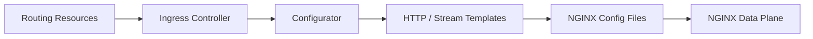

# nginx/kubernetes-ingress

> Ingress controller for NGINX and NGINX Plus, which configures a load balancer according to Kubernetes resources.

## The problem
Exposing applications from a Kubernetes cluster to external clients with routing and TLS.

## What it actually does
Watches Ingress, VirtualServer/VirtualServerRoute and TransportServer resources, validates them, translates them into NGINX configuration and applies it. Handles host and path routing, TLS termination, TCP/UDP. Companion controllers for cert-manager and ExternalDNS; App Protect, telemetry and Prometheus metrics are optional.

## How it is wired

## Trying it
The README gives no command: it points to the Helm chart or the manifests, and to the Cafe example.

## Cost and gotchas
Stable version indicated: 5.6.3. NGINX Plus requires an F5 subscription and an image to build or fetch. Match image, chart and documentation versions.

## What it is not
Not a service mesh nor a full API gateway. Do not confuse it with the Kubernetes community's ingress-nginx.

## Alternatives
The README names no alternatives.

## For you
Ignore for data/AI watch: a network infrastructure building block, worth a look only if you manage cluster exposure.
