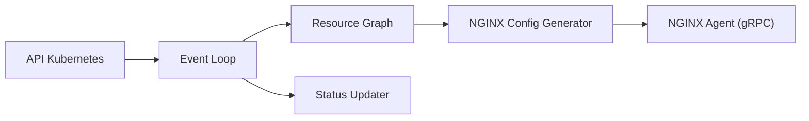

# nginx/nginx-gateway-fabric

> Kubernetes Gateway API implementation that drives NGINX as the data plane.

## The problem
Configuring a load balancer or API gateway on Kubernetes with the standard Gateway API resources rather than annotations.

## What it actually does
A controller that reads `Gateway`, `GatewayClass`, `HTTPRoute`, `GRPCRoute`, `TCPRoute`, `TLSRoute`, `UDPRoute`, validates them, builds a resource graph, generates the NGINX config and deploys it through NGINX Agent. Side branches: policies, WAF bundle polling, status, telemetry, Prometheus metrics. SBOMs are published.

## How it is wired

## Trying it
No install command in this README (no copyable block). Steps mentioned: start a kind cluster, install NGF, deploy the examples; everything is in the NGINX documentation.

## Cost and gotchas
Kubernetes 1.32+ cluster required (current edition). NGINX Plus and F5 WAF versions are possible but commercial. Version 0.Y.Z is unstable, yet the latest release is 2.7.2.

## What it is not
Not a classic Ingress controller nor a service mesh. Not a gateway for LLMs in particular.

## Alternatives
The README cites no alternative.

## For you
Worth watching: a serious Kubernetes infrastructure building block for exposing your serving services, with no direct link to data science.
