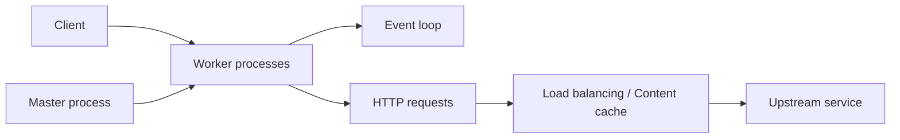

# nginx/nginx

> Web server, reverse proxy, load balancer and cache, for any operator of web services.

## The problem
Serve content, terminate TLS and spread the load in front of applications without exposing them directly.

## What it actually does
A master process reads the configuration and supervises worker processes that handle connections (event loop, shared memory for rate-limiting zones). Static or dynamic modules: HTTP/2, HTTP/3 (QUIC), load balancing, rate limiting, content cache, TCP/UDP proxy (stream) and mail proxy. The configuration is a text file of directives. Stable and mainline versions.

## How it is wired


## Trying it
```bash
git clone https://github.com/nginx/nginx.git
auto/configure
make
sudo make install
sudo /usr/local/nginx/sbin/nginx
curl localhost
```

## Cost and gotchas
Free. The README recommends the official packages over those of distributions. The Windows version is a proof of concept, not to be used in production. Distributions and enterprise support are sold by F5.

## What it is not
Not an application server: it does not run Python. No dynamic-module equivalent without recompiling them or installing them separately.

## Alternatives
No alternative cited in the README.

## For you
Adopt it to expose a model or an API (FastAPI, vLLM) behind a TLS reverse proxy; a standard, proven building block of deployment.
