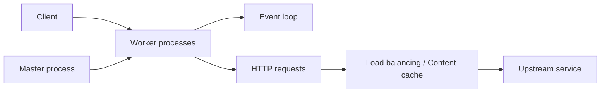

# nginx/nginx

> Serveur web, reverse proxy, répartiteur de charge et cache, pour tout opérateur de services web.

## Le problème
Servir du contenu, terminer le TLS et répartir la charge devant des applications sans les exposer directement.

## Ce que ça fait vraiment
Un processus maître lit la configuration et supervise des processus workers qui traitent les connexions (boucle d'événements, mémoire partagée pour les zones de limitation de débit). Modules statiques ou dynamiques : HTTP/2, HTTP/3 (QUIC), répartition de charge, limitation de débit, cache de contenu, proxy TCP/UDP (stream) et proxy mail. La configuration est un fichier texte de directives. Versions stable et mainline.

## Comment c'est branché


## Essayer
```bash
git clone https://github.com/nginx/nginx.git
auto/configure
make
sudo make install
sudo /usr/local/nginx/sbin/nginx
curl localhost
```

## Coût et pièges
Gratuit. Le README recommande les paquets officiels plutôt que ceux des distributions. La version Windows est un proof of concept, à ne pas utiliser en production. Les distributions et le support entreprise sont vendus par F5.

## Ce que ce n'est pas
Pas un serveur d'applications : il ne fait pas tourner du Python. Pas d'équivalent des modules dynamiques sans les recompiler ou les installer à part.

## Alternatives
Aucune alternative citée dans le README.

## Pour toi
À adopter pour exposer un modèle ou une API (FastAPI, vLLM) derrière un reverse proxy TLS ; brique standard et éprouvée du déploiement.

