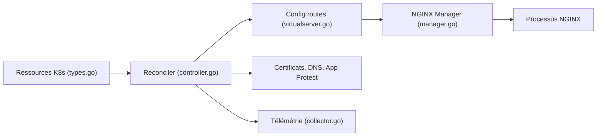

# nginxinc/kubernetes-ingress

> Ingress controller for NGINX and NGINX Plus that configures the load balancer from Kubernetes resources.

## The problem
Exposing a cluster's applications to the outside requires an HTTP load balancer configured according to Ingress resources.

## What it actually does
The controller runs in a pod with NGINX, watches Ingress, VirtualServer/VirtualServerRoute and TransportServer resources, generates the NGINX configuration and applies it through a manager (with rollback). Routing by host and path, TLS termination. Branches: certificate management, ExternalDNS, App Protect (WAF, DoS), health checks, metrics, telemetry. SBOMs are published.

## How it is wired


## Trying it
```bash
# Le README renvoie à la doc : installation par chart Helm ou manifestes.
docker buildx imagetools inspect nginx/nginx-ingress:edge --format '{{ json (index .SBOM "linux/amd64").SPDX }}' | grype
```

## Cost and gotchas
NGINX is free; NGINX Plus images come via the F5 registry (Plus license). Image versions, manifests and docs must match (stable 5.6.3 cited). The "edge" version is for testing.

## What it is not
Not the Ingress controller of the Kubernetes "ingress-nginx" project: it is the NGINX/F5 team's implementation. The README does not detail the contents of the telemetry.

## Alternatives
Not documented in the README: no named alternative.

## For you
Worth watching if your inference cluster or your AI APIs are already behind NGINX; otherwise the Ingress shipped by your platform is enough.
