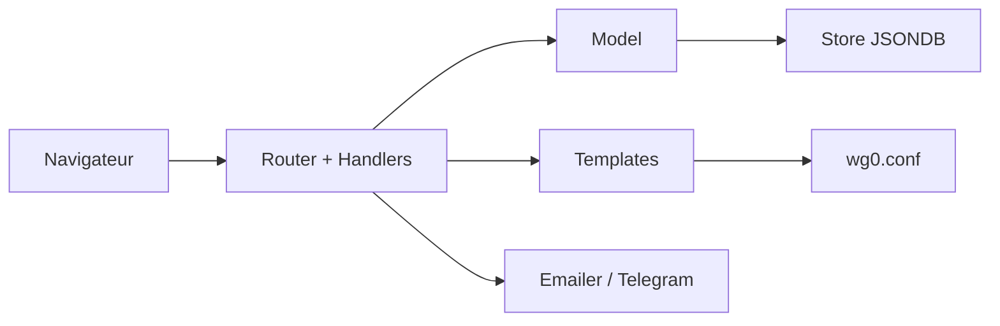

# ngoduykhanh/wireguard-ui

> Web interface to manage a WireGuard installation: clients, configuration, distribution by QR code.

## The problem
Managing WireGuard files, their keys and the deliveries to clients by hand becomes tedious.

## What it actually does
Go server with authentication, client management (name, e-mail...), global settings, `wg0.conf` file generation from a template, sending the configuration by QR code, file, e-mail (SMTP, SendGrid) or Telegram. It only generates the configuration: a systemd or openrc service, or the Docker option, restarts WireGuard.

## How it is wired


## Trying it
```bash
./wireguard-ui
docker-compose up
docker build --build-arg=GIT_COMMIT=$(git rev-parse --short HEAD) -t wireguard-ui .
```

## Cost and gotchas
Free. Default credentials admin/admin: change them, and set `SESSION_SECRET`. WireGuard is not restarted automatically without systemd or `WGUI_MANAGE_RESTART`. Last push in August 2024.

## What it is not
Not a WireGuard client nor a complete network tool: it edits the server configuration.

## Alternatives
No alternative named in the README.

## For you
Worth watching: handy for distributing VPN access to a small team, but barely active and to be hardened before exposure.
