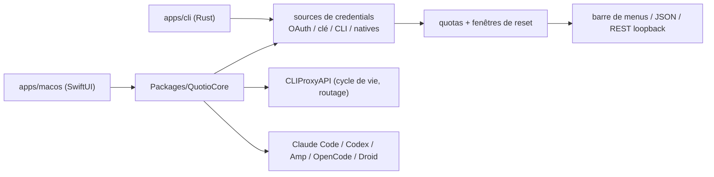

# nguyenphutrong/quotio

> macOS dashboard and CLI to track quotas, accounts and local coding agents.

## The problem
Knowing what is left of your quota with three AI providers means opening three dashboards, and
reconfiguring each coding agent is done by editing configuration files by hand.

## What it actually does
Shows account limits and reset windows from the menu bar, the app, the terminal, a JSON output or a
local REST API. Gathers accounts via the supported credential sources (OAuth, API key, CLI, native)
without copying secrets into project files. Starts and monitors CLIProxyAPI, manages routing. Detects
and configures Claude Code, Codex CLI, Amp, OpenCode and Factory Droid while preserving existing
settings. Two products in the same repository: the SwiftUI app (macOS 14+) and a Rust CLI (macOS
Apple Silicon/Intel and Linux x64), whose npm and Homebrew packages bundle the native binaries — no
Rust toolchain required.

## How it is wired


## Trying it
```bash
brew install --cask nguyenphutrong/tap/quotio
brew install nguyenphutrong/tap/quotio
npm install --global quotio
quotio providers
quotio usage
quotio usage --provider mock --format json
swift test --package-path Packages/QuotioCore
cargo test --manifest-path apps/cli/Cargo.toml --locked --all-features
```

## Cost and gotchas
Free. You need accounts with the tracked providers, and the tool handles their credentials — the
README insists that nothing goes through a hosted Quotio service, which is precisely the point to
check yourself. The full app is reserved for macOS 14 or later.

## What it is not
Not a proxy: CLIProxyAPI is a third-party component that Quotio drives, not something it implements.
Not cross-platform for the visual part: outside macOS, only the CLI remains. The exact lists of
providers and quotas are not in the README, only in the repository's docs.

## Alternatives
No alternative named in the README.

## For you
Useful day to day if you juggle several coding agents; test it before putting your keys in.
