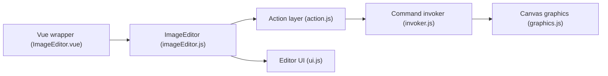

# nhn/tui.image-editor

> HTML5 Canvas image editor in JavaScript, with Vue and React wrappers.

## The problem
Embedding image cropping, drawing and filters in a web page without writing an editor.

## What it actually does
Loads an image into a canvas (fabric.js 4.2.0): crop, flip, rotate, resize, free drawing, shapes, icons, text, masks, filters (sepia, blur, pixelate, etc.), undo/redo, download. Customizable light and dark themes. JS, Vue and React packages.

## How it is wired


## Trying it
No install command in the README (links to the `toast-ui.image-editor`, Vue and React packages). For contributing:
```bash
npm install
```

## Cost and gotchas
Free. Archived repository, last push November 2023; old dependencies (fabric.js 4.2.0).

## What it is not
Not maintained: no fixes to expect.

## Alternatives
None named in the README.

## For you
Ignore: archived and unrelated to data/AI.
