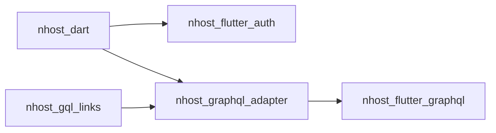

# nhost/nhost-dart

> Dart clients and Flutter widgets for Nhost, an open source Firebase alternative with GraphQL.

## The problem
A Flutter app using Nhost has to handle authentication, storage and GraphQL by hand.

## What it actually does
Five packages: `nhost_dart` (authentication, storage and functions clients), `nhost_flutter_auth` (authentication state as widgets), `nhost_flutter_graphql` and `nhost_graphql_adapter` (GraphQL connections), `nhost_gql_links` (internal). Nhost itself is built on PostgreSQL, Hasura, Hasura Auth and Hasura Storage.

## How it is wired
Simplified diagram based on the sheet, no diagram provided.

## Trying it
No command documented in the README (packages published on pub.dev).

## Cost and gotchas
A Nhost backend (hosted or self-hosted) is required. Dart and Flutter are actually required, not listed among the possible prerequisites.

## What it is not
Not the Nhost backend: only its Dart clients. No code example in the README.

## Alternatives
None named in the README.

## For you
Ignore: Flutter clients unrelated to data / AI work.
