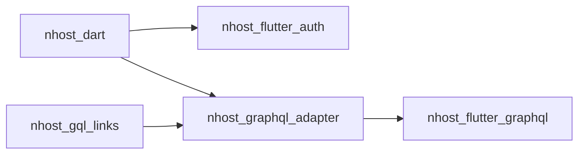

# nhost/nhost-dart

> Clients Dart et widgets Flutter pour Nhost, alternative open source à Firebase avec GraphQL.

## Le problème
Une appli Flutter qui utilise Nhost doit gérer l'authentification, le stockage et GraphQL à la main.

## Ce que ça fait vraiment
Cinq paquets : `nhost_dart` (clients d'authentification, de stockage et de fonctions), `nhost_flutter_auth` (état d'authentification en widgets), `nhost_flutter_graphql` et `nhost_graphql_adapter` (connexions GraphQL), `nhost_gql_links` (interne). Nhost lui-même repose sur PostgreSQL, Hasura, Hasura Auth et Hasura Storage.

## Comment c'est branché
Schéma simplifié d'après la fiche, sans diagramme fourni.

## Essayer
Aucune commande documentée dans le README (paquets publiés sur pub.dev).

## Coût et pièges
Un backend Nhost (hébergé ou auto-hébergé) est nécessaire. Dart et Flutter requis en réalité, non listés dans les prérequis possibles.

## Ce que ce n'est pas
Pas le backend Nhost : seulement ses clients Dart. Pas d'exemple de code dans le README.

## Alternatives
Aucune nommée dans le README.

## Pour toi
Ignorer : clients Flutter sans rapport avec un travail data / IA.

