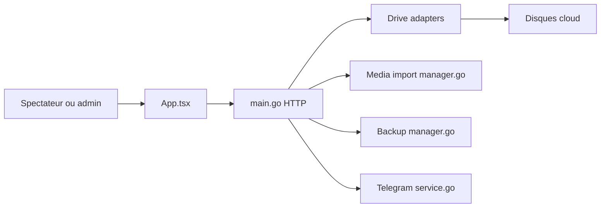

# nianzhibai/91

> Self-hosted personal video site in Go, connected to cloud drives, for private use.

## The problem
Watching your videos stored on several cloud drives without bringing them back or paying for the server's bandwidth.

## What it actually does
Go server + web interface that indexes videos from cloud drives (115, PikPak, 123, OneDrive, Google Drive, WebDAV…). 302 mode to play without consuming the server's bandwidth, vertical "shorts" mode, single-use sharing, import through crawler scripts, backups and Telegram integration. The details of several backend subsystems were not seen in the code.

## How it is wired


## Trying it
```bash
mkdir video-site-91 && cd video-site-91
curl -fsSL https://raw.githubusercontent.com/nianzhibai/91/main/docker-compose.yml -o docker-compose.yml
docker compose up -d
docker exec -it video-site-91 ./server reset-password
```

## Cost and gotchas
Free, but depends on third-party cloud drive accounts. The database also stores the drives' credentials: protect it. README entirely in Chinese.

## What it is not
Not a data/AI tool. The README specifies strictly private use and compliance with the law. iOS is not recommended for shorts mode.

## Alternatives
No alternative cited; the README thanks OpenList (drive interfaces) and ArtPlayer (player).

## For you
Ignore: a personal video site unrelated to data, AI or MLOps, with cloud/crawler content you have no reason to host.
