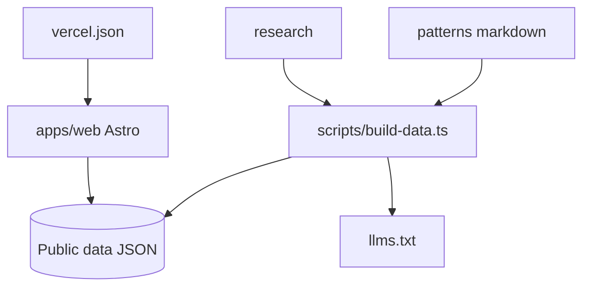

# nibzard/awesome-agentic-patterns

> Catalog of AI agent patterns drawn from real cases, for people building agents.

## The problem
Tutorials show toy demos, and products hide their tricks. Proven methods are hard to find.

## What it actually does
The repository collects markdown sheets (patterns/ folder) sorted into eight categories: memory and context, feedback loops, learning, orchestration, reliability, security, tools, collaboration. Each pattern must be repeated, agent-centered and sourced. An Astro site (apps/web/) lets you search, compare and visualize, with an llms.txt file for assistants.

## How it is wired


## Trying it
```bash
# Aucune commande documentée : lire le site https://agentic-patterns.com
# ou parcourir le dossier patterns/ du dépôt.
```

## Cost and gotchas
Free. The content is uneven by nature: around a hundred patterns, not all of them mature. Expect to do some sorting.

## What it is not
Not a code library: these are ideas and references. Not a standard: it is an editorial selection open to PRs.

## Alternatives
No alternative named in the README.

## For you
Worth adopting as reading material: it contains agent MLOps patterns (evaluation, guardrails, memory) that can be reused directly.
