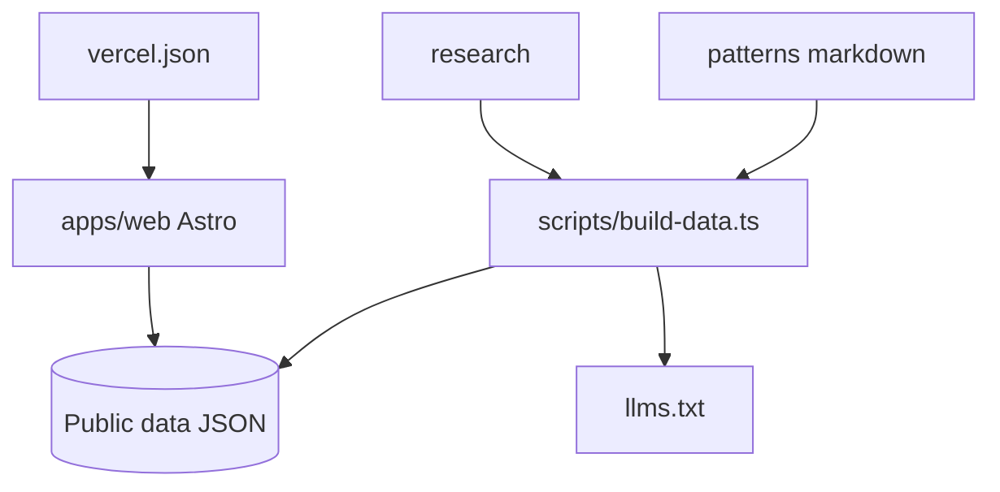

# nibzard/awesome-agentic-patterns

> Catalogue de patrons d'agents IA tirés de cas réels, pour ceux qui construisent des agents.

## Le problème
Les tutoriels montrent des démos jouets, et les produits cachent leurs astuces. Difficile de trouver des méthodes éprouvées.

## Ce que ça fait vraiment
Le dépôt rassemble des fiches markdown (dossier patterns/) classées en huit catégories : mémoire et contexte, boucles de retour, apprentissage, orchestration, fiabilité, sécurité, outils, collaboration. Chaque patron doit être répété, centré agent et sourcé. Un site Astro (apps/web/) permet de chercher, comparer et visualiser, avec un fichier llms.txt pour les assistants.

## Comment c'est branché


## Essayer
```bash
# Aucune commande documentée : lire le site https://agentic-patterns.com
# ou parcourir le dossier patterns/ du dépôt.
```

## Coût et pièges
Gratuit. Le contenu est inégal par nature : une centaine de patrons, tous ne sont pas mûrs. Prévoir du tri.

## Ce que ce n'est pas
Pas une bibliothèque de code : ce sont des idées et des références. Pas un standard : c'est une sélection éditoriale ouverte aux PR.

## Alternatives
Aucune alternative nommée dans le README.

## Pour toi
À adopter comme référence de lecture : on y trouve des patrons de MLOps d'agents (évaluation, garde-fous, mémoire) directement réutilisables.

